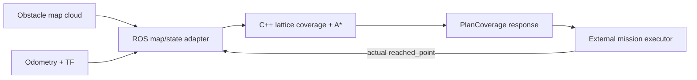
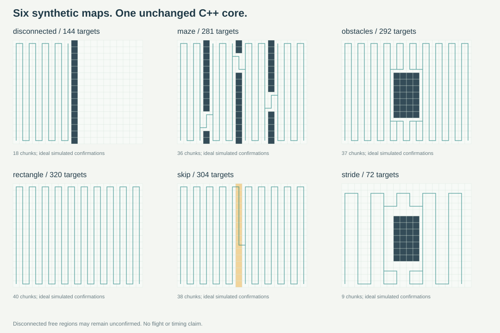

# ccpp_coverage_planner

> **Experimental alpha: v0.1.0-alpha.1.** Evaluate with finite, bounded maps and a FREE in-bounds start. Known defects H02/H03 remain open; no real-flight or production-safety claim is made. See [alpha notes](docs/releases/v0.1.0-alpha.1.md) and [CI evidence](docs/CLOUD_VALIDATION.md).

**Coverage planning for robot search tasks: boustrophedon sweeps, A* connections, and explicit arrival confirmation.**


[](LICENSE)
[](docs/INSTALLATION.md)
[](docs/INSTALLATION.md)
[](https://github.com/lis-y386/ccpp_coverage_planner/actions/workflows/ci.yml)

[中文](README_zh-CN.md) · [Interactive replay](docs/demo.html) · [Install](docs/INSTALLATION.md) · [ROS API](docs/ROS_API.md) · [Validation](docs/VALIDATION.md) · [Release readiness](docs/RELEASE_READINESS.md)


*Actual planner output; synthetic map and ideal arrivals. Animation timing is illustrative, not computation time or aircraft speed.*

## Start here

**No installation:** open [docs/demo.html](docs/demo.html) in your browser. Six embedded maps support play/pause, restart, speed changes and timeline scrubbing. Download the project first: GitHub's file view does not execute HTML. Static hosting is prepared, but **no Pages site has been published**.

**Compute routes yourself**, from this directory:

```bash
git clone https://github.com/lis-y386/ccpp_coverage_planner.git
cd ccpp_coverage_planner
cmake -S . -B build -DCCPP_STANDALONE=ON -DCMAKE_BUILD_TYPE=Release
cmake --build build --parallel
ctest --test-dir build --output-on-failure
./build/ccpp_demo --scenario obstacles --output docs/demo_obstacles
```

Requires C++14 and CMake 3.10+. No ROS, Python, flight stack or GPU is needed for the core executable. [Windows/MinGW commands](docs/INSTALLATION.md).

## Features and intended use

- Persistent 2-D UNKNOWN/FREE/OBSTACLE map from a local obstacle-map cloud.
- Alternating Y-direction column sweeps connected by four-neighbor lattice A*.
- Chunked targets and explicit arrival acknowledgments; planning alone does not mark VISITED.
- Traversable skip rectangles, forbidden rectangles and processed-target neighborhoods.
- A standalone C++ library and ROS1 service adapter; neither commands an aircraft.

Useful for learning coverage planning, reproducible grid experiments and target selection in an external robot mission. This is not a complete navigation stack.

**Map contract:** the ROS adapter assumes its configured rectangular window is fully observed. Missing obstacle returns inside become FREE. Raw sparse LiDAR returns alone do not establish that contract.

## Algorithm and architecture

The core samples FREE lattice nodes every coverage_stride cells, restricts planning to the start-connected component, orders targets by alternating columns, then connects targets with A*. The executor acknowledges actually reached type-1 targets; type-0 points are start/transit. Subsequent requests use the confirmed mask. The ROS adapter can additionally seek known-free frontiers when UNKNOWN remains.

This implementation claims neither optimal route length nor continuous-area completeness. [Algorithm details](docs/ALGORITHM.md).



[Module architecture and standalone data flow](docs/ARCHITECTURE.md).

## ROS quick start

Target: **Ubuntu 20.04 + ROS Noetic + Python 3.8**. This is a legacy target: [Noetic reached EOL on May 31, 2025](https://discourse.ros.org/t/ros-noetic-end-of-life-may-31-2025/43160). Headless ROS was verified in private Linux CI; it is not installed on the current Windows host.

Place this directory at ~/ccpp_ws/src/ccpp_coverage_planner, then in a configured Noetic environment:

```bash
source /opt/ros/noetic/setup.bash
cd ~/ccpp_ws
rosdep install --from-paths src --ignore-src --rosdistro noetic -y
catkin_make -DCMAKE_BUILD_TYPE=Release
source devel/setup.bash
roslaunch ccpp_coverage_planner demo.launch
```

The demo supplies synthetic cloud, odometry and ideal arrival events. No EGO, MAVROS, PX4, YOLO or serial hardware is used. Use an isolated ROS master: /ccpp/* names are absolute.

Headless: `roslaunch ccpp_coverage_planner demo.launch rviz:=false step_delay:=0.0`.
Dependency initialization, installed-space operation and Docker instructions: [INSTALLATION.md](docs/INSTALLATION.md).

## API and configuration

| Interface | Type | Purpose |
|---|---|---|
| /ccpp/plan_coverage | ccpp_coverage_planner/PlanCoverage | Request a chunk; check success and finished |
| /ccpp/reached_point | geometry_msgs/PointStamped | Confirm a physically reached coverage target |
| /ccpp/skip_area | geometry_msgs/PointStamped | Skip a processed-target neighborhood |
| /ccpp/occupancy_grid | nav_msgs/OccupancyGrid | UNKNOWN/FREE/OBSTACLE |
| /ccpp/coverage_grid | nav_msgs/OccupancyGrid | Visited/skip/obstacle state |
| /ccpp/path | nav_msgs/Path | Most recent planned chunk |

```yaml
# Synthetic example, not aircraft deployment settings.
resolution: 0.25
coverage_stride: 2       # nominal target spacing: 0.50 m
chunk_cells: 8           # target budget, not path distance or transit budget
start_from_corner: true
```

Paths use target_frame. waypoint_types aligns with path.poses: 0=start/transit, 1=coverage target. [All topics and parameters](docs/ROS_API.md) · [Mission examples](docs/EXAMPLES.md).

## Scenes and verification



Locally executed: **14/14 CTest entries**, including **11 original GTest cases**; **27 Python tests passed** with **2 strict expected failures** exposing preserved input-validation defects. Counts overlap where CTest invokes GTest; do not add them as independent tests.

Browser, installed-library consumer and quality-check evidence is recorded with actual commands in [VALIDATION.md](docs/VALIDATION.md). Headless ROS/catkin and Docker passed private CI; RViz GUI and physical hardware remain **Not Verified**.

```bash
python -m pytest -q
python tools/verify_provenance.py
python tools/check_project.py
```

[Developer checks](docs/INSTALLATION.md#developer-checks). The recorded snapshot passed private CI on 2026-10-29; see the cloud report. Badges state facts rather than an invented build result.

## Known limitations

- Some invalid direct-core starts and infinite resolution are accepted upstream. **Callers must provide finite bounded geometry and a FREE in-bounds start.** Audit H02/H03 and strict xfail tests preserve these defects for a separately approved fix.
- Completion concerns reachable lattice targets; free islands and camera-footprint gaps can remain.
- No continuous collision avoidance, stale-input timeout, flight execution, visibility-aware ray tracing, online reset or saved-state recovery.
- Chunk budgets count coverage targets; connectors add points and distance.
- Upstream here is **boustrophedon only**: no spiral selector or skip-rectangle revisit.

[Audit](docs/ENGINEERING_AUDIT.md) · [Troubleshooting](docs/TROUBLESHOOTING.md) · [Roadmap](docs/ROADMAP.md)

## Contribute, cite and license

See [CONTRIBUTING.md](CONTRIBUTING.md), [conduct](CODE_OF_CONDUCT.md), [security reporting](SECURITY.md) and issue/PR templates. Include a minimal map, request and expected behavior.

Use [CITATION.cff](CITATION.cff) to cite the software snapshot and commit actually used. No paper, DOI or institutional endorsement is claimed. This version is an experimental source prerelease.

BSD-3-Clause for this package follows upstream metadata. Dependency/asset provenance, including xmlrpcpp's LGPL-2.1 declaration, is in [THIRD_PARTY.md](docs/THIRD_PARTY.md). External dependencies retain their own license terms; see the source provenance and distribution notes.

Extracted from [drone at 8bc54d2](https://github.com/lis-y386/drone/tree/8bc54d2bdb257b3f2f357b1709350e28d25f35cc/src/ccpp_coverage_planner). Core, ROS node, public header, service and original tests are unchanged. [Provenance](docs/PROVENANCE.md).
