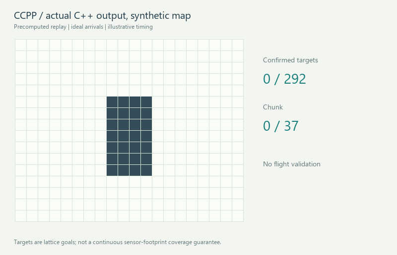
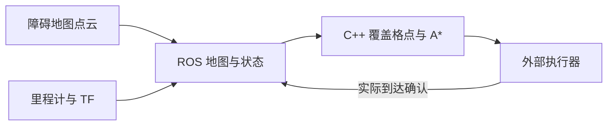

# ccpp_coverage_planner

> **实验性测试版 v0.1.0-alpha.1。** 两个输入校验缺陷 H02/H03 仍开放，调用者需保证地图有限、尺寸合理且起点在界内 FREE 格。此版本不代表生产或实飞可靠性。[版本说明](docs/releases/v0.1.0-alpha.1.md) · [CI 证据](docs/CLOUD_VALIDATION.md)

**机器人搜索任务的覆盖路径规划：牛耕式扫描、A* 衔接、实际到达确认。**


[English](README.md) · [交互演示](docs/demo.html) · [安装](docs/INSTALLATION.md) · [接口](docs/ROS_API.md) · [验证](docs/VALIDATION.md)



路径来自实际 C++ 核心运行；地图和到达是合成数据。动画时间不是规划耗时或飞机速度。

## 快速体验

直接用浏览器打开 docs/demo.html，无需 ROS、Python 或网络依赖。六种地图支持播放、暂停、重启、速度与时间轴调节。GitHub 文件预览不会执行 HTML，需要下载后本地打开。已准备静态托管文件，但没有发布 Pages。

```bash
cmake -S . -B build -DCCPP_STANDALONE=ON -DCMAKE_BUILD_TYPE=Release
cmake --build build --parallel
ctest --test-dir build --output-on-failure
./build/ccpp_demo --scenario obstacles --output docs/demo_obstacles
```

依赖 C++14 与 CMake 3.10+。Windows/MinGW 见[安装指南](docs/INSTALLATION.md)。

## 原理与能力

核心独立于 ROS：在自由覆盖格点上找起点连通分量，沿 Y 逐列往返排序，以四邻接格点 A* 衔接，分批返回目标。ROS 适配器负责点云投影、地图状态、确认和未知边界探索。

只有实际到达的类型 1 目标经任务端确认后才写 VISITED；类型 0 为起点/中转。跳过区省略目标但允许通行；禁行区禁止覆盖与中转。项目不执行飞控、视觉、投放或持续避障。



**地图假设：** 配置窗口内无障碍点的格子会被当成 FREE，必须由上游提供可靠的完整局部占据信息，不能把稀疏原始 LiDAR 点云直接当成自由空间依据。

## ROS 编译运行

目标为 Ubuntu 20.04 / ROS Noetic / Python 3.8。Noetic 已于 2025-05-31 EOL，本机未验证 ROS 运行。将本目录放在 ~/ccpp_ws/src/ccpp_coverage_planner：

```bash
source /opt/ros/noetic/setup.bash
cd ~/ccpp_ws
rosdep install --from-paths src --ignore-src --rosdistro noetic -y
catkin_make -DCMAKE_BUILD_TYPE=Release
source devel/setup.bash
roslaunch ccpp_coverage_planner demo.launch
```

自带合成世界，不依赖飞机或 EGO/MAVROS/YOLO。无图形界面添加 rviz:=false step_delay:=0.0。接口为绝对名称，需隔离 master。

服务 /ccpp/plan_coverage 返回 success、finished、path 和对齐的 waypoint_types。实际到达类型 1 点后发布 /ccpp/reached_point。[完整接口](docs/ROS_API.md) · [集成示例](docs/EXAMPLES.md)。

## 测试与边界

实际执行：14/14 CTest 条目通过，其中包含 11 个原始 GTest；Python 为 27 通过、2 个严格预期失败。预期失败复现非法起点和无限分辨率校验缺陷，不表示已修复；测试计数不能简单相加。

浏览器回放、安装消费、格式及静态分析结果见[验证记录](docs/VALIDATION.md)。无界面 ROS/catkin 与 Docker 已通过私有云端 CI；RViz 图形界面和实机仍未验证。

核心直接调用者需保证有限、合理尺寸地图和界内 FREE 起点。完成只针对可达覆盖格点，不保证连续地面视野覆盖。没有过期输入保护、在线重置、持久化恢复或飞行中碰撞复查。此上游版只有牛耕式，不含螺旋或跳过区回访。

[算法](docs/ALGORITHM.md) · [架构](docs/ARCHITECTURE.md) · [审查](docs/ENGINEERING_AUDIT.md) · [路线图](docs/ROADMAP.md)

## 贡献、引用与许可

[贡献方式](CONTRIBUTING.md) · [软件引用](CITATION.cff) · [第三方清单](docs/THIRD_PARTY.md) · [发布准备](docs/RELEASE_READINESS.md)。

采用上游声明的 BSD-3-Clause，外部依赖保留各自许可，具体来源见第三方清单。不声明关联论文、DOI 或机构背书；此版本为实验性源码预发布。源码来自 8bc54d2；核心、ROS 节点、公共头、服务和原始测试保持不变。
