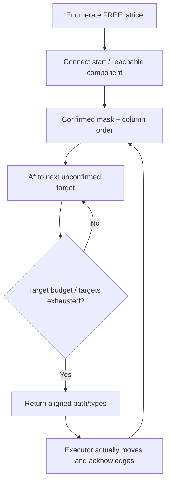

# Algorithm and state

Source: [core](../src/grid_planner.cpp), [header](../include/ccpp_coverage_planner/grid_planner.h), [ROS adapter](../src/ccpp_planner_node.cpp), unchanged from 8bc54d2. This is column-wise lattice coverage, not a claim of new theory, shortest coverage length or continuous-area completeness.

## Input contract

Grid has width/height, resolution, origin metadata and row-major occupancy: -1 unknown/outside, 0 FREE, 100 occupied. The core uses integer cells; the ROS adapter handles world coordinates.

Provide bounded finite geometry, matching occupancy length, and a FREE in-bounds start. Upstream clamps stride to at least 1 and ignores initial_heading. Grid.valid does not reject infinity and dimension multiplication is signed int. The connection sampler omits the source for nonzero segments; some illegal starts can be accepted. H02/H03 are reproducible, preserved defects.

## Core sequence

1. Enumerate FREE lattice nodes at x/y multiples of stride.
2. Select the nearest node with a sampled clear connection from requested_start. Core output begins at that node; the ROS adapter prepends the exact world position.
3. Flood-fill the four-neighbor lattice to obtain the start-connected component. Edges sample intermediate fine cells.
4. Import the confirmed/unavailable mask only if its size matches occupancy; mismatched masks are ignored, not rejected.
5. Order columns: ascending Y in even X columns, descending Y in odd columns.
6. Choose the first target using sweep_after_rank, nearest corner candidate, or proximity. Corner selection uses Manhattan distance, not an optimal-route proof.
7. A* connects each unconfirmed target over the reachable lattice. Final target points are type 1; connector points are type 0. max_new_cells counts targets.
8. Return the schedule; completion depends on previously confirmed/unavailable nodes, not newly planned ones.

## Adapter and completion

The adapter transforms float32 XYZ cloud points, applies the z slice, point threshold and quantized inflation. A hull mask shrinks the boundary. Forbidden rectangles block targets and transit; preset skip rectangles omit targets but remain traversable. skip_area marks nearby lattice nodes visited.

The rectangular local observation window is assumed fully observed; absent obstacles there become FREE. This is not visibility/occlusion-aware ray tracing. persistent_obstacles determines whether old obstacles inside a new window can disappear.

The core completes its reachable lattice component. The adapter additionally checks UNKNOWN: when known goals are confirmed but UNKNOWN remains, a fine-grid breadth-first search seeks a reachable FREE frontier. No frontier means failure, not completion.

reached_point and skip_area update VISITED. Planning and odometry alone do not. The executor's acknowledgment is trusted rather than checked against odometry. A request scheduling the last target is not complete until a later call after confirmation.

Completion does not prove sensor-footprint coverage, continuous collision freedom or passage through sub-stride corridors. No spiral or revisit mode exists. Proposed changes are in [ROADMAP](ROADMAP.md).
