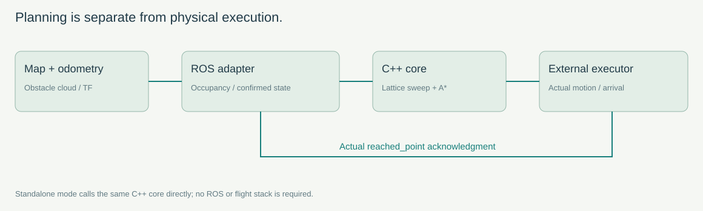
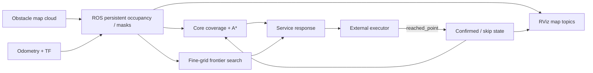
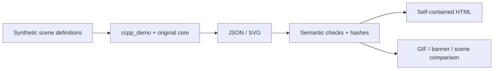

# Architecture

| Layer | Files | Role |
|---|---|---|
| Public API | include/ccpp_coverage_planner/grid_planner.h | Grid, Cell, PlanResult, GridPlanner |
| Core | src/grid_planner.cpp | Lattice graph, column order, A*, budget |
| ROS adapter | src/ccpp_planner_node.cpp | Cloud/odom/TF, world-grid conversion, state, frontier, service |
| External executor | Outside this package | Physical motion, stopping, mission actions, truthful arrival |
| Native example | examples/standalone_demo.cpp | Synthetic maps, ideal confirmations, assertions, JSON/SVG |
| ROS example | scripts/demo_world.py | Synthetic map/odom and request/ack loop |
| Offline viewer | tools/demo_template.html → docs/demo.html | Render embedded C++ data; no JavaScript planner |

The core imports only its public header and standard C++. There is no EGO/MAVROS/PX4/YOLO package linkage. The adapter's fully observed local-map assumption remains a semantic integration requirement.

## Reproducible display pipeline

JSON is the authoritative route record. HTML embeds six datasets without network fetches. Images derive from the same route records, not hand-drawn results. Native and ROS scenes exercise different layers and are not the same experiment: ROS adds inflation and forbidden/skip masks.

Default build is catkin. CCPP_STANDALONE=ON exports ccpp::grid_planner without ROS. CMake does not download dependencies. Names /ccpp/* are preserved absolute interfaces; multi-robot users need explicit remaps or separate masters.
